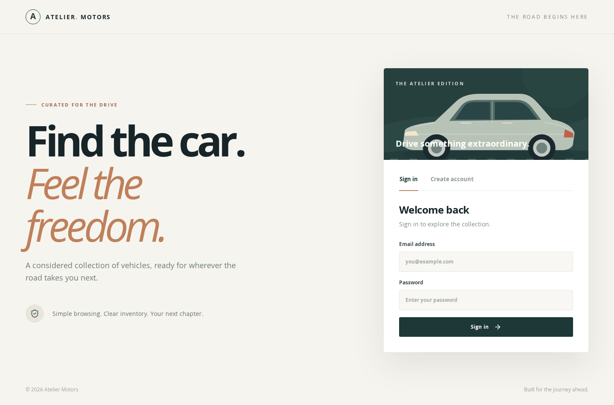
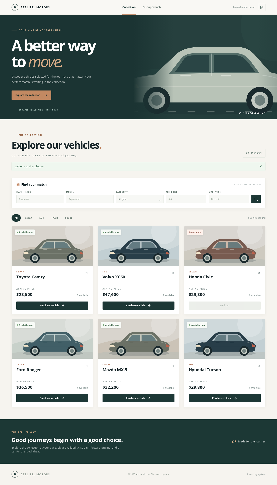
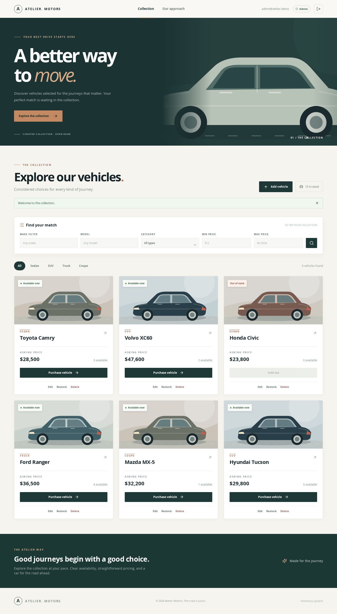

# Atelier Motors — Car Dealership Inventory System

A full-stack inventory application with account registration, JWT login, searchable vehicle listings, admin inventory management, and stock-safe purchases. The React SPA talks to a FastAPI REST API backed by an on-disk SQLite database. A purchase reserves one unit of inventory; it does **not** process payment.

## Stack and project layout

| Layer | Technology | Location |
|---|---|---|
| API | FastAPI, SQLAlchemy, Pydantic, JWT, bcrypt | `backend/app/` |
| Database | Persistent SQLite file | `backend/dealership.db` by default |
| SPA | React, Vite, HTML5, CSS3, Tailwind CSS | `frontend/src/` |
| Tests | pytest; Vitest and React Testing Library | `backend/tests/`, `frontend/tests/` |

The backend separates HTTP routers, schemas, ORM models, authentication dependencies, and vehicle business logic. The frontend keeps API calls in `src/api.js` and UI components in `src/App.jsx`.

## Run locally on Windows

Requirements: **Python 3.11+**, **Node.js 20+**, npm, and Git. Run commands from the repository root unless a step says otherwise.

1. Install backend dependencies and set a private JWT secret:

   ```powershell
   python -m venv .venv
   .venv\Scripts\python -m pip install -r requirements.txt
   Copy-Item .env.example .env
   ```

   Edit the root `.env`: replace `JWT_SECRET` with a long random value. Keep `.env` out of Git. `DATABASE_URL` defaults to a persistent SQLite file; because the API runs from `backend`, the example URL creates `backend/dealership.db`.

2. Start the API in terminal 1:

   ```powershell
   cd backend
   ..\.venv\Scripts\python -m uvicorn app.main:app --reload
   ```

   API: `http://localhost:8000`; interactive documentation: `http://localhost:8000/docs`; health check: `http://localhost:8000/health`. Tables are created on startup.

3. Install and start the SPA in terminal 2:

   ```powershell
   cd frontend
   npm ci
   Copy-Item .env.example .env.local
   npm run dev
   ```

   Open `http://localhost:5173`. The SPA reads `VITE_API_BASE_URL` from `frontend/.env.local` (default: `http://localhost:8000`). Configure allowed frontend origins through root `.env` `CORS_ORIGINS` (comma-separated); localhost and 127.0.0.1 on port 5173 are allowed by default. Restart the relevant server after changing an environment file.

4. Create an admin account if you need inventory management. Register normally in the SPA, then from the `backend` directory run:

   ```powershell
   ..\.venv\Scripts\python -m scripts.bootstrap_admin --email you@example.com
   ```

   Sign out and sign back in. Public registration always grants the `user` role; admin promotion is local CLI only. The SPA checks `/api/auth/me`, and the server enforces all roles independently of the UI.

On macOS/Linux, replace `.venv\Scripts\python` with `.venv/bin/python`, `Copy-Item` with `cp`, and `..\.venv\Scripts\python` with `../.venv/bin/python`.

## User flows

Register or sign in, browse the full inventory, filter by make/model/category and inclusive price bounds, and purchase available stock. A sold-out vehicle remains visible with its Purchase button disabled. Admins can add, replace, restock, and delete listings. Search text matches **exactly, ignoring case**, and filters combine with AND. `%` and `_` are treated as literal text. The dashboard reloads inventory after mutations.

## API

Send `Authorization: Bearer <access_token>` for every vehicle endpoint. `POST /api/auth/login` returns that token; `GET /api/auth/me` returns the current account and role. Admin endpoints return `403` for an authenticated ordinary user; absent/invalid/expired credentials return `401`.

| Method | Path | Access | Behavior |
|---|---|---|---|
| POST | `/api/auth/register` | Public | Create an ordinary account (`201`) |
| POST | `/api/auth/login` | Public | Obtain a bearer token |
| GET | `/api/auth/me` | Signed in | Get current account and database role |
| POST | `/api/vehicles` | Admin | Create a vehicle (`201`) |
| GET | `/api/vehicles` | Signed in | List all vehicles, including quantity 0 |
| GET | `/api/vehicles/search` | Signed in | Filter with `make`, `model`, `category`, `min_price`, `max_price` |
| PUT | `/api/vehicles/{id}` | Admin | Replace all vehicle fields |
| DELETE | `/api/vehicles/{id}` | Admin | Delete a vehicle (`204`) |
| POST | `/api/vehicles/{id}/purchase` | Signed in | Decrement stock by one (`409` if sold out) |
| POST | `/api/vehicles/{id}/restock` | Admin | Add positive `amount` to stock |

A vehicle has a numeric ID, make, model, category, positive price, and nonnegative integer quantity. Create/update send all fields, for example:

```json
{"make":"Toyota","model":"Camry","category":"Sedan","price":28500,"quantity":3}
```

Restock sends `{"amount":5}`. Invalid fields return `422`; unknown IDs return `404`. Purchase uses `UPDATE ... WHERE quantity > 0` to prevent negative stock under simultaneous requests. The concurrent test uses independent SQLite connections.

## Tests and build

From the root:

```powershell
.venv\Scripts\python -m pytest -q
cd frontend
npm test
npm run build
```

The backend tests use distinct temporary **on-disk** SQLite files. A separate WAL/NullPool fixture tests concurrent purchases. See [TEST_REPORT.md](TEST_REPORT.md) for the exact verified results and the scope of the tests.

## Screenshots

These are actual captures of the running SPA connected to a locally seeded API. The demo database and sample accounts are not included in the repository.

| View | Capture |
|---|---|
| Sign in |  |
| Buyer inventory |  |
| Responsive mobile inventory |  |
| Admin inventory |  |

## My AI Usage

I used **Cursor** for the initial authentication implementation and tests, **Google Antigravity** for the first Phase 2 inventory implementation and its RED test commit, and **ChatGPT** to review and correct search behavior, implement the React frontend and API integration, add frontend tests, run an independent test suite, and capture the final UI. I inspected generated code and test output, and corrected discrepancies before documenting results.

AI sped up scaffolding and helped cover more flows, but it also produced claims that required checking. Search was documented as exact while its original `ilike` query treated `%` as a wildcard; a new failing regression test exposed the issue. An earlier draft of the prompt log summarized responses instead of preserving them verbatim. I corrected the code and left clear placeholders for conversations I cannot recover. I am responsible for reviewing the final behavior, completing the raw record, and presenting only commits and test runs that actually exist.

The root [PROMPTS.md](PROMPTS.md) contains the available prompt text and identifies missing raw AI exchanges. Paste those exchanges verbatim or add public chat links before submitting. Do not substitute generated summaries.

## Submission status

The code, tests, build, screenshots, and documentation are included. The remaining submission actions are to complete `PROMPTS.md` with original chat logs/links, commit any uncommitted work under the assignment's AI co-authorship rule, and publish the Git repository to obtain a public URL. A live deployment is optional.
